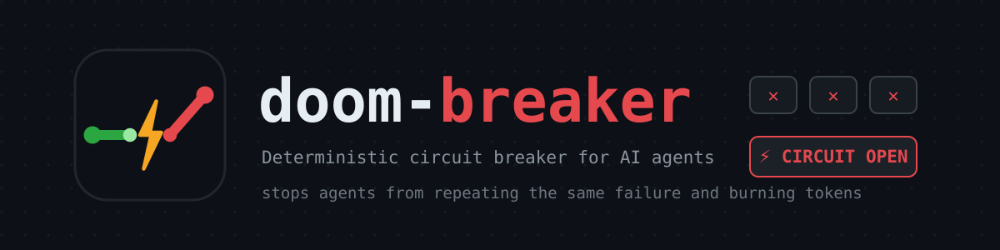
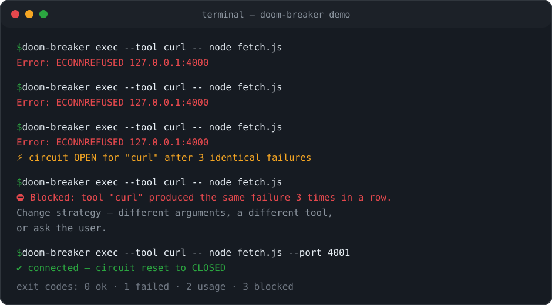
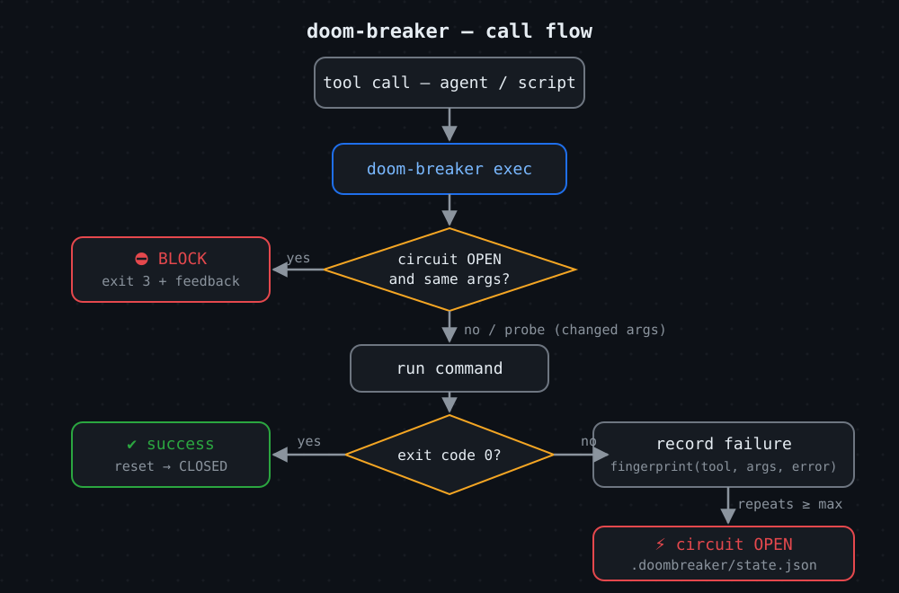

<div align="center">



[](https://github.com/Doojyaan/doom-breaker/actions/workflows/ci.yml)
[](LICENSE)
[](package.json)
[](package.json)

**Stop your AI agent from burning tokens on repeating the same failure.**

`doom-breaker` wraps any tool call, fingerprints each failure deterministically, and
blocks the *next identical* call with a corrective message — so the agent changes
strategy instead of looping.

</div>

---

## The problem

Agents get stuck in **doom loops**: they call the same tool with the same arguments,
get the same error, and try again — 10, 15, 20 times. Every repeat costs tokens, time,
and attention. Research confirms repetition makes agents *worse* at following rules,
not better (ARCBench, [arXiv:2608.11888](https://arxiv.org/abs/2608.11888)); user
complaints about repeated identical tool calls are constant across Claude/Codex
issue trackers and r/ClaudeAI.

Retry libraries (`tenacity`, p-retry) *repeat on purpose* — the opposite of what an
agent needs. doom-breaker is a **circuit breaker**: it opens the circuit after
`N` identical failures and refuses the next identical call.

## What it looks like



## How it works



1. **Preflight** — if the circuit for this tool is `OPEN` and the upcoming call has
   the *same arguments fingerprint* as the failing chain, the call is **blocked**
   (exit code 3) and the agent receives a corrective message instead.
2. **Run** — otherwise the command executes normally, output is passed through untouched.
3. **Fingerprint** — every failure is hashed: `SHA-256(tool, args, normalized error)`.
4. **Record** — consecutive identical failures are counted in a local state file.
5. **Trip** — at `--max-repeats` (default 3) identical failures the circuit opens.

### Changed strategy? You're allowed through.

A call with *different arguments* is never blocked, even when the circuit is open —
changing the approach is exactly what doom-breaker wants to encourage. One success
closes the circuit and resets the counter.

### What counts as "the same failure"

Error text is normalized so noise doesn't create fake differences:

| Noise | Normalized to |
|---|---|
| Timestamps (`2026-11-16T10:00:00.000Z`) | `<ts>` |
| Memory addresses (`0xDEADBEEF`) | `0x<addr>` |
| Big counters/sizes (`123456 ms`) | `<n>` |

Small meaningful numbers survive (`HTTP 404` stays `404`).

## Install

```bash
npm install -g doom-breaker
# or run without installing (Node >= 18):
npx doom-breaker --help
```

## Usage

```bash
# protect any command
doom-breaker exec --tool curl -- curl -s https://api.example.com/health

# agent-friendly, machine-readable events
doom-breaker exec --tool deploy --json -- ./deploy.sh prod

# inspect and recover
doom-breaker status
doom-breaker reset deploy          # clear one tool
doom-breaker reset                 # clear all
```

### Options

| Flag | Meaning | Default |
|---|---|---|
| `--tool <name>` | logical tool name | command name |
| `--max-repeats <n>` | identical failures before the circuit opens | `3` |
| `--state-file <path>` | where circuit state lives | `.doombreaker/state.json` |
| `--json` | emit machine-readable JSON events | off |

### Exit codes

| Code | Meaning |
|---|---|
| `0` | command succeeded |
| `1` | command failed (passed through from the child) |
| `2` | usage error |
| `3` | **blocked** — circuit open, identical call refused |

### State file

Plain JSON, atomic writes, corrupt-file safe:

```json
{
  "version": 1,
  "tools": {
    "curl": {
      "state": "open",
      "lastFingerprint": "a1b2c3d4e5f60718",
      "lastArgsFingerprint": "9f8e7d6c5b4a3210",
      "repeatCount": 3,
      "openedAt": "2026-11-16T10:00:00.000Z"
    }
  }
}
```

## Design principles

- **Deterministic** — no LLM calls, no heuristics; the same input always yields the same decision.
- **Local-first** — state is a JSON file in your repo; nothing leaves your machine.
- **Zero dependencies** — Node built-ins only; the whole tool is ~200 lines of TypeScript.
- **Safe by construction** — commands run without a shell (no interpolation, no injection surface).

## Design & docs

Logo, palette, and usage rules live in [`docs/DESIGN.md`](docs/DESIGN.md); scope and
decision history in [`docs/00 - SCOPE.md`](docs/00%20-%20SCOPE.md). All artwork is
hand-crafted SVG committed in [`assets/`](assets/).

## Roadmap

- [ ] **v0.2** — MCP stdio proxy mode: protect *every* tool call of a running agent
- [ ] **v0.2** — `watch` mode over agent transcripts
- [ ] **v0.3** — half-open probe state and per-tool policies
- [ ] **v0.3** — similarity fallback for near-identical (not byte-identical) failures

## Contributing

Issues and PRs welcome — keep PRs small and deterministic like the tool itself.
Run `npm test` before submitting (19 tests must pass).

## License

[MIT](LICENSE) © Doojyaan (Syahadatul Aditya)
